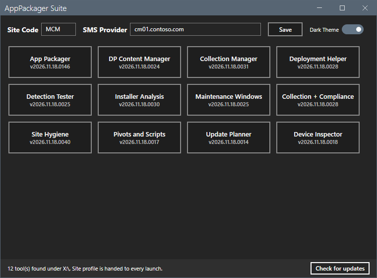

# AppPackager Suite

[](https://github.com/jasonulbright/app-packager-suite/releases/latest)
[](https://github.com/jasonulbright/app-packager-suite/releases)
[](#requirements)
[](LICENSE)

Shared core module (`SuiteCommon`) for a family of Configuration
Manager admin tools. Each consumer tool carries a vendored copy at
`Lib\SuiteCommon\` so every tool stays fully standalone - no module
installation, no gallery dependency.

## What SuiteCommon provides

| Area | Functions |
|---|---|
| Logging | `Initialize-Logging` (`-Attach`, `-VerboseLogging`), `Write-Log` (INFO/WARN/ERROR/DEBUG, `-Quiet`), `Write-LogErrorRecord` |
| CM connection | `Connect-CMSite`, `Disconnect-CMSite`, `Test-CMConnection`, `Get-CMConnectionInfo`, `Resolve-ConfigurationManagerModulePath`, `Test-CMSiteCodeMatchesProvider` |
| Settings | `Read-SuiteSettings` (flat defaults merge), `Save-SuiteSettings` |
| Window chrome | `Install-TitleBarDragFallback` (+ the WM_NCHITTEST hook family), `Save-WindowState`, `Restore-WindowState` |
| Theming | `Initialize-SuiteTheme`, `Update-TitleBarBrushes`, `Update-SidebarButtonTheme`, `Set-ButtonTheme`, `Set-DialogTheme` |
| Dialogs | `Show-ThemedMessage`, `Show-ConfirmDialog` |
| Background work | `New-SuiteBgRunspace`, `Stop-SuiteBgWork`, `Close-SuiteBgRunspace` |
| CM widgets | `Build-CollectionTree`, `Show-CollectionPickerDialog` |
| Identity | `Get-SuiteCommonVersion` |

`Connect-CMSite` imports the ConfigurationManager module (from
`SMS_ADMIN_UI_PATH` or known console install paths), creates the site
PSDrive with `-Scope Global` so sibling modules can resolve the CMSite
location, rebuilds a stale drive whose provider connection died, and
verifies the site with `Get-CMSite` (skip it with
`-SkipSiteVerification`). DEBUG console output turns on with
`Initialize-Logging -VerboseLogging` or the `SUITE_VERBOSE` environment
variable; the SMS Provider computer can be set with a parameter or
`SUITE_CM_PROVIDER`.

## Launcher



`start-suite.ps1` is a thin WPF shell: one tile per installed suite
tool, discovered as sibling folders of this repository (override the
root in `suite.settings.json`), with each tool's version read from its
CHANGELOG. Every tile launches its tool as a separate process. The
active site - site code and SMS provider - is chosen once in the Site
box and the SMS Provider box at the top of the launcher window. The
Site box lists the sites you used before, and a new three-character
code can be typed. Save writes the choice to `active-site.json` in
`%LOCALAPPDATA%\AppPackagerData` and hands it to each launch through
the `SUITE_CM_SITECODE`, `APP_PACKAGER_SITE` and `SUITE_CM_PROVIDER`
environment variables; `Connect-CMSite` falls back to the provider
variable, so tools connect without per-tool configuration. Each tool
keeps its site data (preferences with the site values, reports,
history, run files) in
`%LOCALAPPDATA%\AppPackagerData\sites\<SITE>	ools\<tool>`, so the
data of one site never shows in another. A tool that is already open
keeps its site until you restart it, and its footer says when the
launcher uses another site. The first start of a tool after an update
copies its old site data into the site folder and keeps the old files.
The layout is in `docs/reference/site-data-contract.md`. The footer
shows the status text and the Check for updates button; a long status
text ends in an ellipsis, and its tooltip shows the whole text. The
launcher embeds no tools and hosts no plugins.

## All-in-one installer

`installer\suite.nsi` builds `SuiteSetup-<version>.exe`, a single
installer carrying every suite tool plus this repository (the launcher
and `SuiteCommon`). Thirteen components ship:

| Component | Folder | Entry script |
| --- | --- | --- |
| AppPackager Suite Launcher | `app-packager-suite\` | `start-suite.ps1` |
| App Packager | `app-packager\` | `start-apppackager.ps1` |
| Site Hygiene | `site-hygiene\` | `start-sitehygiene.ps1` |
| Collection and Compliance Manager | `collection-and-compliance-manager\` | `start-ccm.ps1` |
| Collection Manager | `collection-manager\` | `start-collectionmanager.ps1` |
| Deployment Helper | `deployment-helper\` | `start-deploymenthelper.ps1` |
| Detection Method Tester | `detection-tester\` | `start-detectiontester.ps1` |
| DP Content Manager | `dp-content-manager\` | `start-dpcontentmgr.ps1` |
| Installer Analysis | `installer-analysis\` | `start-installeranalysis.ps1` |
| Maintenance Window Manager | `maintenance-window-manager\` | `start-maintenancewindowmgr.ps1` |
| Pivots and Scripts | `pivots-and-scripts\` | `start-pivotsandscripts.ps1` |
| Update Planner | `update-planner\` | `start-updateplanner.ps1` |
| Device Inspector | `device-inspector\` | `start-deviceinspector.ps1` |

Update Planner builds a wave plan for software update rollouts and can create the deployments behind an Enable actions switch. Device Inspector shows one device in read-only panels. The panels show the operating system and the client health from the device. They show the discovery data, the hardware inventory, the collections, the deployments and the required software updates from the site. Both read the site with the ConfigurationManager cmdlets and need the Configuration Manager console on the computer.

The component list lives in one table in
`tools\build-suite-installer.ps1`. That table drives staging, the
manifest, and the generated `components.nsh` that `suite.nsi` includes,
so adding a tool is one row.

```powershell
.\tools\build-suite-installer.ps1                        # version = build date
.\tools\build-suite-installer.ps1 -SuiteVersion 1.0.0    # explicit version
```

The build stages each component from the local sibling repository at its
current commit, so it packages what is checked in, not what is sitting
dirty in the working tree. Output lands in `installer\out\` along with
`checksums.txt`.

What the installer does:

- **Installs per user, with no elevation prompt.** Everything goes to
  `%LOCALAPPDATA%\AppPackagerSuite\`, one folder per component, and the
  Add/Remove Programs entry is written under `HKCU`. Nothing touches
  `Program Files`, the HKLM registry hive, or another user's profile.
- **Checks for a newer suite release** once a day. The launcher shows an
  Update banner with Release notes and Update buttons; Update downloads
  the signed installer from the release, verifies its SHA-256 against
  `checksums.txt` and its Authenticode signature, closes the launcher,
  runs the setup silently and reopens the launcher. Every tool shows a
  one-line notice when the same check finds an update and points to the
  launcher; no tool updates itself inside a suite install. The check
  reads `https://api.github.com/repos/jasonulbright/app-packager-suite/releases/latest`
  through `curl.exe` and caches the answer in
  `%LOCALAPPDATA%\AppPackagerSuite\update-check.json`. A plain checkout
  (no `suite-manifest.json`) never checks.
- **Creates a start-menu group, "AppPackager Suite"**, with a shortcut
  for each of the twelve tools and one for the launcher, which carries the
  suite icon. Each shortcut runs
  `powershell.exe -NoProfile -ExecutionPolicy Bypass -File <entry>.ps1`,
  so the tools start regardless of the computer's execution policy without
  changing that policy for anything else.
- **Writes `suite-manifest.json`** at the install root, recording the
  suite version and the version and commit of each bundled component.
- **Supports `/S`** for a silent install, and the uninstaller supports it
  too.

### Upgrading

Run the newer installer over the existing install. Files that ship in the
package are replaced; files that do not ship are left alone. That covers
your settings and window state (`*.json`), the `Logs\` folders, and the
downloaded icon pack at `app-packager\Packagers\Icons\` - all of them
survive an upgrade untouched.

Two earlier components, ConfigMgr Health Dashboard and Supersedence and
Dependency Auditor, folded into Site Hygiene. An upgrade over an install
that still holds them zips each old folder in full to
`site-hygiene\legacy\<component>.zip` (through `powershell.exe`
`Compress-Archive`) and checks the zip. When that name exists, the new zip
gets a time stamp, so an earlier archive is never overwritten. Then
`installer\retire-component.ps1` merges every file of the old folder into
`site-hygiene\legacy\<component>\` through `merge-user-folder.ps1`: a new
file moves, an identical file is dropped, and a file with different content
is kept under a numbered name. The old folder goes only when no file is
left in it, and its Start Menu shortcut goes with it. A folder whose zip
fails is left in place. Site Hygiene imports the dashboard's settings and
history from the legacy folder on its next launch.
`Tests\SuiteInstaller.Upgrade.Tests.ps1` exercises this path with a fixture
installer under a temporary folder.

A tool saves its own templates in its `Templates\` folder, beside the shipped
ones. The installer places the shipped templates through
`installer\suite-userdata.ps1` and records them in `suite-defaults.json`. A
missing template is copied. A template you never edited is replaced by the
new default. A template you edited stays as it is, and the new default is
written beside it as `<name>.new`. A template written by an older installer
has no record, so a template that differs from the new default counts as
edited.

The launcher folder was named `suite-core\` in earlier installers. An
upgrade renames it to `app-packager-suite\`. When both folders exist,
setup moves each file of `suite-core\` that is absent from
`app-packager-suite\`, deletes a file with identical content, and keeps a
file with different content under `app-packager-suite\legacy\suite-core\`.
Setup deletes `suite-core\` only when no file is left in it. A file that
cannot move, for example one that a running tool holds open, stays in
`suite-core\`, and the next upgrade continues the merge.

Uninstalling removes only the files the installer shipped: preferences,
logs, downloaded icons, edited templates, and anything else written after
install stay in place, and folders holding them survive. A component folder
disappears entirely only when it holds nothing of yours. An untouched default
template is deleted. The last page of the uninstaller lists the folders that
stay and where they are, including the folders under `%LOCALAPPDATA%` that
suite tools share with other tools. A check box, "Also delete my data in the
suite folders", is off by default. It removes the component folders under the
install root and nothing else. A silent uninstall (`/S`) never shows the
page and never deletes data.

### The SmartScreen warning

The installer is unsigned. The first time you run a new build, Windows
will likely show a blue "Windows protected your PC" box that hides the
Run button behind **More info**. This is Windows saying it has not seen
this exact file before, not that it found anything wrong with it.
Compare the file's SHA-256 against the `checksums.txt` published with
it, then choose **More info** followed by **Run anyway**. The warning
returns for each new build, because every build is a new file.

## Consuming

A tool module loads its vendored copy once, globally:

```powershell
if (-not (Get-Module SuiteCommon)) {
    Import-Module (Join-Path $PSScriptRoot '..\Lib\SuiteCommon\SuiteCommon.psd1') -Global -DisableNameChecking
}
```

Consumers never edit the vendored copy. Changes land in this repository
and re-vendor with the sync script:

```powershell
.\sync-suitecommon.ps1          # copy current core into consumers
.\sync-suitecommon.ps1 -Check   # report drift, exit 1 if any
```

Drift detection is content-hash based, so both version skew and local
edits to a vendored copy are caught.

## Requirements

- Windows PowerShell 5.1
- Configuration Manager console for the CM connection functions
  (logging and settings work without it)

## License

MIT.
